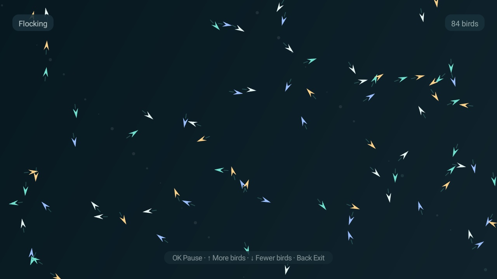
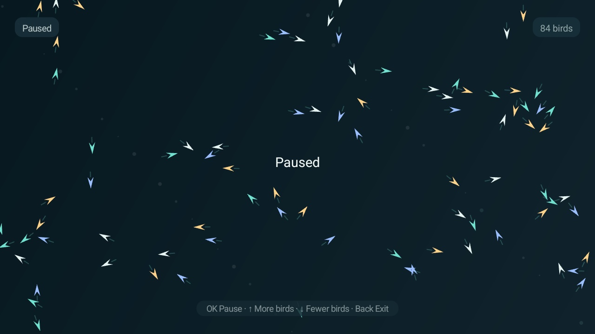

# Flock

An interactive flocking simulation for Android TV. Each bird reacts to nearby birds; simple local rules produce the collective movement seen in flocks and schools of fish.

## Screenshots

Captured on a TCL 32S5K running Android TV 14 at 1280 × 720.





## How it works

The model implements the three classic boids rules:

- **Separation:** steers a bird away from very close neighbors.
- **Alignment:** turns it toward the average heading of nearby birds.
- **Cohesion:** steers it toward the local center of the group.

Each bird considers neighbors inside a local radius. Position and velocity use elapsed frame time, speed is capped, and the screen edges wrap around. The simulation starts with 84 birds; the remote adjusts the flock from 24 to 180. Neighbor lookup is quadratic in flock size and capped at 180 agents.

## Controls

| Remote key | Action |
|---|---|
| **OK / Enter** | Pause or resume |
| **↑** | Add 12 birds, up to 180 |
| **↓** | Remove 12 birds, down to 24 |
| **Back** | Close the simulation |

## Build and install

Requires JDK 17 and Android SDK Platform 34.

```sh
./gradlew --no-daemon testReleaseUnitTest lintRelease assembleRelease
adb install -r app/build/outputs/apk/release/app-release.apk
```

Open **Flock** from the TV's app launcher.

## Permissions

None. The app does not access the network, files, or location, and starts no background services. Animation stops when the activity closes.

## Tested on

The upstream project records testing on a TCL 32S5K running Android TV 14. Test remote navigation and rendering on your own device before release.
